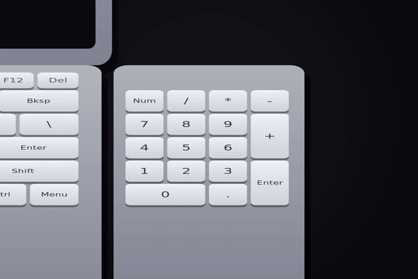

# C-Key

<p align="center">
  
</p>

A compact touch bar for DankMaterialShell: a numpad, a brightness slider and a volume
slider, floating at the bottom center of the screen.

## Demo

The full video (13 s, 1200×800) is in [`media/c-key.mp4`](media/c-key.mp4):

- Your numpad explodes, because your laptop doesn't have one.
- `Super + Shift + C` and the touch bar shows up on the screen.
- Your touchpad *is* the touch bar: the keys you press are the keys you get.

## What it does

- **Numpad** that types into the focused application, like an on-screen keyboard.
- **Vertical sliders** for screen brightness and volume, with drag.
- It shows up **only while you hold the shortcut** (Mod+Shift+C by default) and hides
  itself when you let go.
- It is a fixed window on the `overlay` layer: it can't be dragged around, and it
  floats above your windows.
- **The touchpad becomes the touch bar.** While the shortcut is held, the touchpad stops
  moving the cursor, and whatever key you press on the panel is the key you get.
- **The mouse gets blocked and hidden** while the panel is up, and the cursor comes back
  to the center of the screen when you let go.
- Keys are 20% darker than the panel, and both follow the same opacity slider.

## Requirements

- DankMaterialShell 1.6 or newer.
- `wtype`, to type the keys into the focused app.
- A C compiler, if you want to build the helper.
- niri, for the shortcut and for hiding the cursor (see below).

## Install

The short way, on niri:

```bash
curl -fsSL https://raw.githubusercontent.com/mcloving-exe/C-Key/main/setup.sh | sh
```

That installs the plugin, the native helper and the niri shortcut. It asks for sudo only
to install the helper, and it touches your niri config by adding a single `include`
line (the original is backed up first).

To undo it:

```bash
curl -fsSL https://raw.githubusercontent.com/mcloving-exe/C-Key/main/setup.sh | sh -s -- --uninstall
```

By hand, the plugin itself is just QML:

```bash
mkdir -p ~/.config/DankMaterialShell/plugins/C-Key
cp plugin.json CKeysDaemon.qml CKeysBar.qml CKeysSettings.qml \
   ~/.config/DankMaterialShell/plugins/C-Key/
```

Then in DMS: **Settings → Plugins → scan for plugins → enable C-Key**.

The touchpad part needs a small native helper:

```bash
sudo ./install.sh
```

It compiles `ckeys-hold`, installs it to `/usr/local/bin` and enables a systemd
service. See [Why the helper needs root](#why-the-helper-needs-root).

## The niri shortcut

The shortcut doubles as the panel toggle, so niri has to swallow it, otherwise the "C"
ends up in whatever you were typing. The bind does nothing on its own:

```kdl
binds {
    Mod+Shift+C { spawn "true"; }
}
```

And to hide the cursor while the panel is up, niri can hide it while you type:

```kdl
cursor {
    hide-when-typing true
}
```

Note that niri 26.04 uses the `key value` syntax, without `=`.

Change the combination with `ckeys-hold <mod> <shift> <key>`, using Linux input key
codes (`125` = Super, `42` = Shift, `46` = C).

## Settings

Everything is under **Settings → Plugins → C-Key**:

| Setting | What it does |
|---|---|
| Bar Width | Panel width. Default 495 px |
| Bar Height | Panel height. Default 287 px |
| Bar Color | Color of the brightness and volume bars |
| Accent Color | Border color while the panel is pinned |
| Panel Opacity | How transparent the panel is |
| Show Icons | Show the sun and speaker icons under the bars |

The default size (495 × 287 logical pixels) is the size of a typical touchpad: the
kernel reports it as 100 × 58 mm, and a 310 mm wide 1536 px screen gives 0.2 mm per
pixel. With that, the panel is the same size as the touchpad and the finger-to-key
mapping is 1:1, like a phone screen.

## IPC

```bash
dms ipc call ckeys show      # show
dms ipc call ckeys hide      # hide
dms ipc call ckeys toggle    # toggle
dms ipc call ckeys pin       # pin (it stays up)
dms ipc call ckeys unpin
dms ipc call ckeys status
dms ipc call ckeys key 5     # type a 5 into the focused app
dms ipc call ckeys touch 0.5 0.3   # finger position on the touchpad
dms ipc call ckeys release   # finger lifted
dms ipc call ckeys center    # center of the screen
```

## How the touchpad part works

While the shortcut is held, `ckeys-hold`:

1. Grabs every pointer device (the touchpad, its "Mouse" sibling node and the mice)
   with `EVIOCGRAB`, so the cursor can't move and clicks don't reach the app. The grab
   is released the moment you let go.
2. Reads the multitouch events (`ABS_MT_POSITION_X/Y`) and sends the normalized
   coordinates to the plugin, at most once every 25 ms. Sending one IPC call per event
   was too slow, since every call starts the DMS client.
3. Tells the plugin when the finger lifts, so the next touch counts as a new key
   instead of a drag.
4. On release, asks the plugin where the screen center is and moves the cursor back
   there.

The plugin hit-tests those coordinates against its own widgets, so the mapping is 1:1:
the key you press is the key you see.

### Why the helper needs root

Reading `/dev/input` is controlled by the cgroup device policy, and the compositor
takes the keyboard and touchpad exclusively through logind's `TakeDevice`. In practice
only the compositor and root can open those devices: a user process gets `EACCES`
even with the right ACL and even in the `input` group. The helper therefore runs as a
system service and drops privileges before talking to DMS over IPC.

The plugin itself is plain QML and runs as your user, like every other DMS plugin.

## Development

```bash
./deploy.sh            # copy to the plugin dir and reload
./deploy.sh restart    # also restart DMS
```

QML caches `CKeysBar.qml` separately from the daemon, so a plain reload won't pick up
changes to it. That's why the deploy script restarts DMS.

## Credits

This is my own implementation for DankMaterialShell on Linux, by
[mcloving-exe](https://github.com/mcloving-exe). It was inspired by a touchbar app for
macOS that I saw on Instagram.

An LLM was used as an assistant while writing the code. Every line, the wording and
the bugs are mine.

## License

MIT
